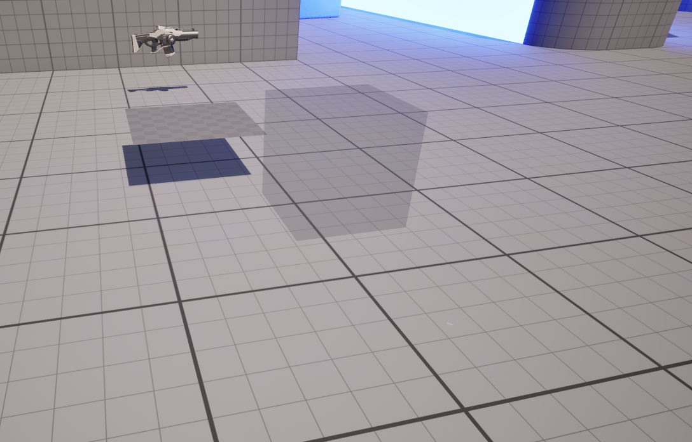
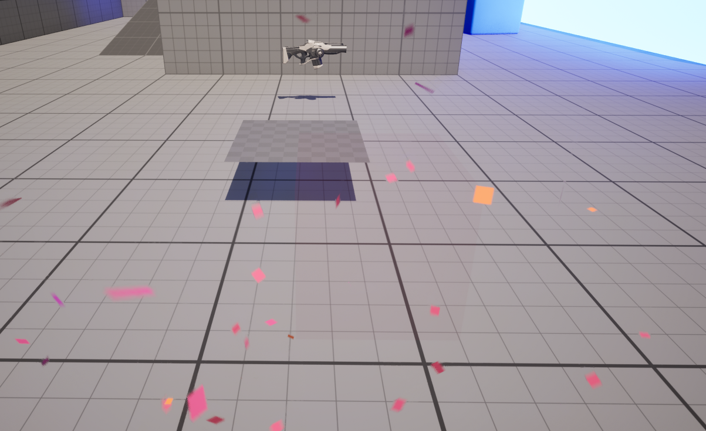
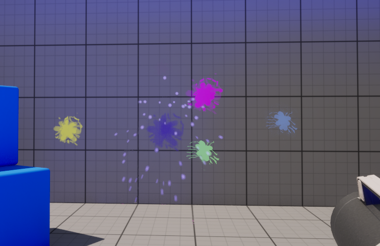
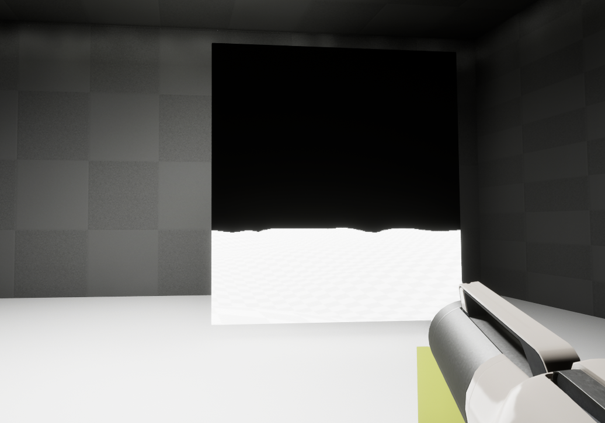
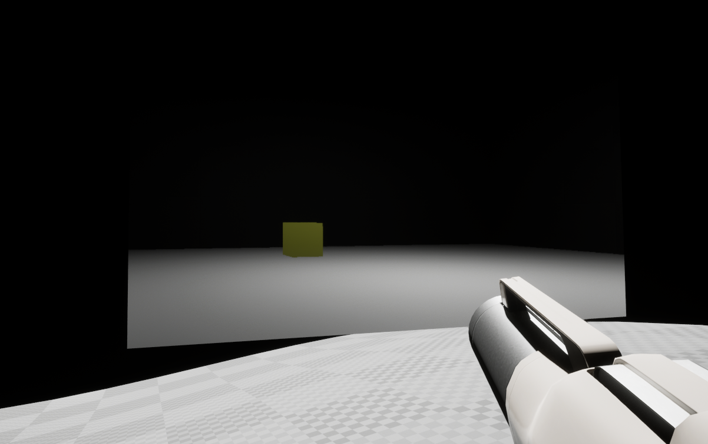

# Unreal Engine 5.4 — C++ Gameplay and Visual Effects Experiments

**Portfolio preparation copy — not yet approved for publication**

A collection of Unreal Engine 5.4 coursework experiments involving C++ gameplay systems, projectile impact effects, dynamic materials, procedural meshes, and portal mechanics. These are **technical demonstrations**, not a completed commercial game.

## Highlights

- **Projectile impact and splatter effects:** C++ projectile logic generates a random color, applies it to a dynamic material, and reuses the color for decals and Niagara effects on impact.
- **Dynamic material interaction:** A C++ actor responds to overlaps by changing material parameters and spawning a colored Niagara effect.
- **Procedural terrain:** Perlin noise creates terrain vertices; projectile impacts can modify mesh vertices in an impact radius.
- **Portal experiment:** C++ overlap detection teleports the player between linked portals, with a brief cooldown and scene-capture updates.
- **Additional mesh experiments:** C++ procedural plane generation and static-to-procedural mesh conversion.

## Gameplay gallery

Screenshots captured from the tested Unreal Engine 5.4 portfolio copy. These show prototype systems and technical experiments rather than a finished game.

### Dynamic material and particle interaction

**Before interaction**

**Particle response**

### Color-synchronized projectile impacts

The C++ projectile logic coordinates randomized impact colors across splatter decals and Niagara effects.

### Linked portal experiment

### Procedural terrain demonstration

[Watch the procedural terrain demonstration (MP4, approximately 17.7 MB)](Demonstration.mp4)

The accompanying video demonstrates the procedural terrain experiment in motion.

## Implementation details

| System | Representative source |
| --- | --- |
| Projectiles, decals, Niagara color synchronization | [`FirstPerson415Projectile.cpp`](Source/FirstPerson415/FirstPerson415Projectile.cpp) |
| Dynamic material parameter changes | [`CubeDMIMod.cpp`](Source/FirstPerson415/CubeDMIMod.cpp) |
| Perlin terrain generation and impact deformation | [`PerlinProcTerrain.cpp`](Source/FirstPerson415/PerlinProcTerrain.cpp) |
| Portal overlap and scene capture | [`Portal.cpp`](Source/FirstPerson415/Portal.cpp) |
| Procedural mesh generation | [`ProcPlane.cpp`](Source/FirstPerson415/ProcPlane.cpp) and [`ProcMeshFromStatic.cpp`](Source/FirstPerson415/ProcMeshFromStatic.cpp) |

## Technology

- Unreal Engine **5.4**
- **C++**, Unreal gameplay framework, Blueprints
- Niagara visual effects, dynamic material instances, decals
- Procedural Mesh Component
- Git and **Git LFS** for Unreal binary assets

## Setup and testing

1. Install Unreal Engine **5.4**, including the C++ development toolchain for your platform.
2. Clone the repository with **Git LFS** enabled and run `git lfs pull` to download binary Unreal assets.
3. Open `FirstPerson415.uproject` and allow Unreal to generate/build project files if prompted.
4. Inspect the available maps (`FirstPersonMap`, `PortalMAP`, and `ProcTerrainMAP`) and test their relevant mechanics.

**Local verification completed:** The author opened and compiled this clean portfolio copy in Unreal Engine 5.4, confirmed that FirstPersonMap loads and shooting works, verified projectile colors, decals and splatter effects, tested linked portals in PortalMAP, and confirmed procedural terrain generation and projectile-driven deformation in ProcTerrainMAP.

## Origin and attribution

This repository originates from GAM-415 coursework. The first-person template and associated template assets originated with Epic Games; C++ coursework additions and experiment-specific content are presented for technical demonstration. Epic and any other third-party content remain subject to their respective licenses. The exact redistribution status of binary template assets must be reviewed before making a source repository public.

## Publication checklist

- [x] Confirm that Git LFS-managed assets are available in the tested clean private copy
- [x] Verify UE 5.4 C++ build and test the projectile, portal, and terrain showcase systems
- [ ] Confirm the origin and rights of any included non-original assets
- [x] Capture screenshots and a short demonstration video of working mechanics
- [x] Create a separate private clean-history portfolio repository
- [ ] Confirm school-assignment timing and permissions before any public release

**Keep private until explicitly approved.**
